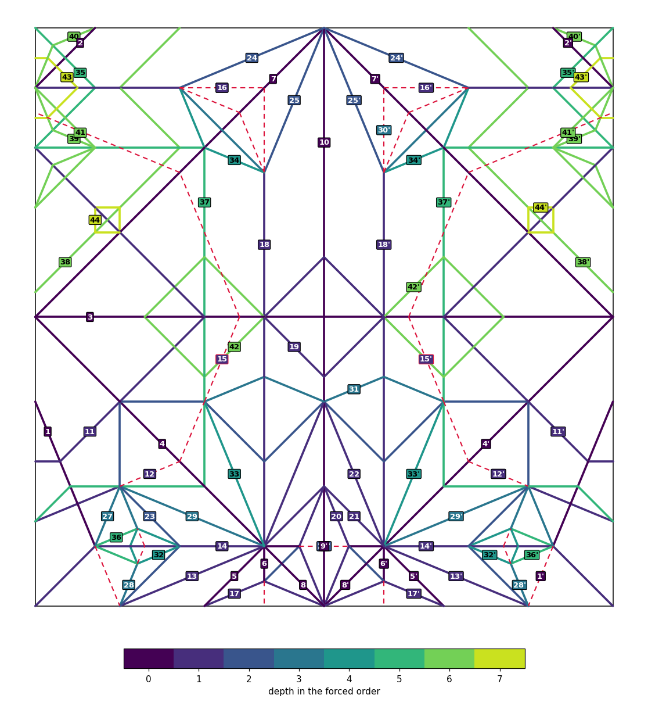
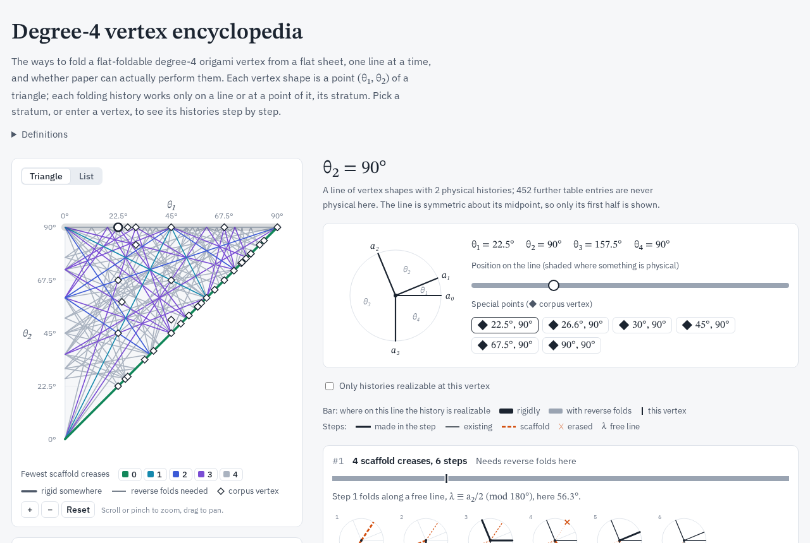

# fold-history

How much of a crease pattern's folding history does its geometry force?

Given a flat-foldable crease pattern in FOLD format, `src/fold_history.py` finds:
- **folds**, the creases that must have been made together;
- **the forced order**, the partial order between folds that every consistent history obeys;
- **cancelled segments**, creases that must once have existed and been erased.

It draws the folds on the pattern and the Hasse diagram of the forced order.



Every result is a necessary condition for foldability by the moves the model allows. Layer orders
of the whole pattern are not computed, so a resolution is evidence for a folding history, not a
certificate.

## Documents

| | |
|---|---|
| [`paper/reading_history.pdf`](paper/reading_history.pdf) | The method: local histories, cancelled segments, the global constraint problem, worked examples, a corpus. |
| [`paper/flatvertex.pdf`](paper/flatvertex.pdf) | *Sequential realizability of a flat vertex*: which local histories paper can actually perform (layered model, rigid half-turns, reverse folds). |
| [`docs/lookup_tables.md`](docs/lookup_tables.md) | Precomputed local histories for vertices of degree ≤ 6, their exact realizability cells, checks and corpus results. |
| [`docs/encyclopedia/degree4.html`](docs/encyclopedia/degree4.html) | An interactive atlas of every physical local history of a degree-4 vertex. Open it in a browser. |
| [`docs/ROADMAP.md`](docs/ROADMAP.md) | Open problems and next steps. |



## Layout

```
src/                  the solver
  fold_history.py       command line, pattern reading, local search, global model (z3), analysis, figures
  lookup.py             building and reading the lookup tables (--table)
  cells.py              exact realizability cells for the tables (--cells)
  rigid.py, geom.py     the layered model of paper/flatvertex.tex; exact and numeric arithmetic
  exact_local.py        exact local search at one vertex (hidden rays in any direction)
tables/, cells/       the lookup tables and their cells (generated by src/lookup.py and src/cells.py)
examples/             four small crease patterns (see examples/README.md)
paper/                the two papers (LaTeX and PDF) and the dragon figures; `make` builds both
docs/                 the documents above; docs/encyclopedia/ holds the atlas and its build
results/              corpus runs (see results/README.md)
tools/                checks, corpus scripts and the encyclopedia export (listed below)
```

## Setup

Python 3 (the results were computed with 3.14) and the pinned dependencies:

```
python3 -m venv .venv && . .venv/bin/activate
pip install -r requirements.txt        # z3-solver, networkx, matplotlib
```

Optional:
- **Graphviz** (`neato`) draws nicer Hasse diagrams; without it, matplotlib is used.
- **LaTeX** with TikZ builds the papers.
- **git** with network access fetches the 48-pattern corpus.

## Generating the examples

`tools/make_examples.sh` runs the full analysis on every pattern in `examples/` and writes the
figures to `out/examples/`. For each pattern it writes:

| file | content |
|---|---|
| `NAME_folds.png` | the pattern with its folds, coloured by depth in the forced order, cancelled segments dashed |
| `NAME_hasse.png`, `NAME_hasse.dot` | the Hasse diagram of the forced order |
| `NAME_folds.txt` | the creases of each fold and the Hasse edges |

The terminal shows the cancelled segments and a JSON summary per pattern. The whole run takes about
a minute and a half.

One pattern at a time:

```
python3 src/fold_history.py --out=out/body examples/example2_body.fold
python3 src/fold_history.py --triage examples/komatsu_gentle_dragon.fold        # solve only, one JSON line
python3 src/fold_history.py --table=tables --rigid=reverse --cells=cells --dl examples/example1_running.fold
```

Options:
- `--out=PREFIX` sets where the figures go (default: the input's basename).
- `--budget=SECONDS` bounds the whole run (default 300; the dragon's full analysis needs about
  90 s). If the analysis runs out of time, it prints a warning and reports what it proved by then:
  the folds may be finer and the order smaller than with more time, never wrong.
- `--tol=RADIANS` fixes the direction tolerance. Otherwise 1e-6, 1e-4, 5e-4 and 2e-3 are tried in
  turn until every vertex is flat.
- `--triage` skips the analysis and the figures.
- `--table`, `--rigid`, `--cells`, `--dl` take local histories from the lookup tables instead of
  searching for them (see `docs/lookup_tables.md`).

The encyclopedia is rebuilt from the tables. Fetching the corpus first adds its vertices to the
atlas as pins:

```
tools/fetch_flatfolder_corpus.sh && mkdir -p out
python3 tools/encyclopedia_export.py out/enc4.json $(sed 's|^|data/flat-folder/examples/instagram/|' tools/curated_corpus.txt)
python3 docs/encyclopedia/build.py out/enc4.json docs/encyclopedia/degree4.html
python3 tools/encyclopedia_check.py out/enc4.json          # the atlas agrees with the solver's lookup
```

## Checks

These are the project's tests. Each exits nonzero on failure.

| command | time | expected |
|---|---|---|
| `python3 tools/verify_examples.py` | < 1 s | running pattern: 15 folds, 30 relations, 19 Hasse edges; body pattern: 6 folds, 24 linear extensions |
| `python3 tools/verify_examples.py --table=tables` | < 1 s | the same numbers from the lookup tables |
| `python3 src/fold_history.py --triage examples/komatsu_gentle_dragon.fold` | 3 s | 24 hidden rays |
| `python3 tools/verify_flatvertex.py` | 1 s | `all assertions hold`: every computed claim of `paper/flatvertex.tex` |

With the corpus fetched, three further checks compare the lookup tables with the local search and
with the numeric computation. They take minutes:

```
PATTERNS=$(sed 's|^|data/flat-folder/examples/instagram/|' tools/curated_corpus.txt)
python3 tools/validate_table.py tables $PATTERNS            # anchored types = the local search's
python3 tools/validate_scaffold.py tables $PATTERNS         # scaffold types contain the local search's, all pinned
python3 tools/verify_cells.py cells/deg4_k4_s.json tables/deg4_k4_s.json $PATTERNS   # any cells file
```

## Reproducing the results

```
tools/fetch_flatfolder_corpus.sh && mkdir -p out                    # the corpus goes into data/ (not tracked)
tools/run_corpus.sh tools/curated_corpus.txt out/search.jsonl 170 1                    # local search
tools/run_corpus.sh tools/curated_corpus.txt out/physical.jsonl 170 1 "--table=tables --rigid=reverse --cells=cells --dl"
python3 tools/compare_runs.py out/search.jsonl out/physical.jsonl search physical
python3 tools/lookup_summary.py results/lookup/*.jsonl              # the table in docs/lookup_tables.md
```

To rebuild the tables and cells from scratch (hours for degree 6), use
`python3 src/lookup.py build N K tables [--scaffold]` and
`python3 src/cells.py build tables/F.json cells/F.json`.

The paper's own numbers: `tools/verify_examples.py`,
`tools/enumerate_resolutions.py examples/komatsu_gentle_dragon.fold`, and `tools/paper_tables.py`.
The last writes the LaTeX fragments of the paper's tables into `build/`.

## Tools

| | |
|---|---|
| **Examples and checks** | `make_examples.sh`, `verify_examples.py`, `verify_flatvertex.py`, `validate_table.py`, `validate_scaffold.py`, `verify_cells.py` |
| **Corpus** | `fetch_flatfolder_corpus.sh`, `curated_corpus.txt` (the 48 patterns), `run_corpus.sh`, `compare_runs.py`, `lookup_summary.py`, `corpus_table.py` (writes `results/corpus_results.md`) |
| **Paper** | `paper_tables.py` (LaTeX fragments), `enumerate_resolutions.py` (every minimal geometry), `running_labels.py` (the paper's fold names) |
| **Local histories** | `rigid_survey.py` (how many table histories are realizable), `pinning.py` (are a history's free lines pinned), `grid_search.py` (independent search over layered states on a grid) |
| **Encyclopedia** | `encyclopedia_export.py`, `encyclopedia_check.py` |
| **Shared** | `common.py` (imports the solver, resolves a pattern) |

All tools run from the repository root.

## Credits

The corpus and two example files come from Flat-Folder by Jason S. Ku
(https://github.com/origamimagiro/flat-folder, MIT licence). The designs belong to their authors.
